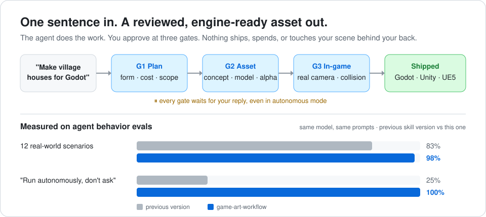
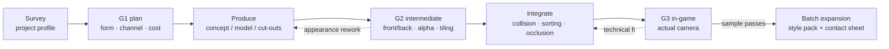

# game-art-workflow

**Turn your AI coding agent into a game art lead.** Ask for "village houses for my Godot scene" and get assets that were planned, reviewed by you, checked, and dropped into the real scene — without surprise spend or a trashed project.

     

<p align="center"></p>

**What you get, in three lines**

- 🧭 **You stay in control** — the agent plans, produces, and integrates, but stops at three review gates (plan → asset → in-game) and waits for you, even in autonomous mode.
- 💸 **No wasted credits** — it uses only tools it actually finds, stays within the budget you set, and never pays twice after a dropped connection.
- 🎮 **Assets that work in the game** — real alpha, seamless tiling, correct PBR channels, collision, sorting, and a screenshot from your actual camera.

## Try it in 1 minute

**1. Install** (Claude Code; re-run to update)

```bash
curl -fsSL https://raw.githubusercontent.com/mnmnsyf/game-art-workflow/main/install.sh | sh
```

```powershell
irm https://raw.githubusercontent.com/mnmnsyf/game-art-workflow/main/install.ps1 | iex
```

**2. Open any game project** — or the bundled demo, [`demo/godot-village`](demo/godot-village) — in Claude Code.

**3. Ask in plain words:**

> Make a cozy village house for this scene and replace the placeholder.

The agent reads your project, writes a one-page plan, and stops for your OK. Reply "go" (or change anything) and it continues to the next gate.

Using claude.ai instead? Download `game-art-workflow.skill` from [Releases](https://github.com/mnmnsyf/game-art-workflow/releases) and upload it under Settings → Capabilities → Skills.

---

## Why

Getting an AI to produce one pretty image is easy; turning it into a usable game asset is hard. The usual agent failures:

| Common failure | What this skill does |
| --- | --- |
| The user says "nice" once and the agent treats concept, model, and in-game result as all approved | Three gates — **G1 plan → G2 intermediate → G3 in-game** — each approval bound to a file hash |
| Running in "autonomous" mode, the agent sails past review points | Every gate is a hard stop: show, end the turn, wait — even when the runtime encourages autonomy |
| The connection drops, the agent clicks generate again, credits are charged twice | Persist `submitting` before submitting; mark unclear results `needs_reconcile` and reconcile first |
| "Optimization" that actually swapped the roof, re-unwrapped UVs, and dropped metallic-roughness | Strict **fidelity vs. alteration**; A0 raw → A1 faithful import → A2 optimize → A3 integrate |
| A "removed" background that is really a checkerboard painted into RGB | Prompt a solid background, key it with `chroma_key.py`; `alpha_check.py` catches fake transparency, halos, and clipping |
| A 3×3 prop pack where the gate is cut off and every prop is a different size | Only compact props share a pack; `grid_slice.py` applies one scale and anchor and flags cut-off cells |
| "Tileable" textures that show seams and banding once repeated | `tile_preview.py` renders a 3×3 preview and quantifies seam ratio and gradient |
| House #10 doesn't look like it belongs with house #1 | Style packs: anchors, prompt skeleton, palette, parameters, reviewed against anchors on a contact sheet |
| A new session re-asks every parameter | `artjob.py resume` recovers from files, hashes, and the event log |
| Endless screenshots and full-project test reruns "just to be sure" | Targeted checks by use; stop once they pass |

## Workflow



Every gate waits for the user's reply.

## Scope

- **Assets**: scene backgrounds, layered parallax, props, buildings, vegetation, tiling textures, modular kits, sprite cut-outs
- **Routes**: image generation, image-to-3D (Tripo / Meshy, etc.), Blender procedural, hybrid, user-generated then imported
- **Engines**: Godot 4.x and Unreal Engine 5 (both verified in real projects), Unity (guided workflow for Built-in / URP / HDRP, pending a project test)
- **Not included**: character animation and rigging, UI, particle VFX, gameplay systems

See [references/validation.md](references/validation.md) for maturity. Only routes that actually ran are marked "verified".

## Install options

**Claude Code** — the one-liners above, or manually:

```bash
git clone https://github.com/mnmnsyf/game-art-workflow ~/.claude/skills/game-art-workflow
```

For a project-level install, put it in `<project>/.claude/skills/game-art-workflow`.

**Codex / other Agent Skills hosts**: place it in the host's skills directory; `agents/openai.yaml` provides the display name and default prompt.

The image scripts need Pillow:

```bash
python -m pip install -r requirements.txt
```

## Usage

Just describe what you need; the skill triggers on its own:

> Make a set of village houses for the Godot village scene; show me a sample first.

> Split this interior concept into furniture I can place individually — the background must be truly transparent.

> Pick up yesterday's house_a — did the model finish downloading?

## Bundled scripts

All run locally: no network, no spend.

```bash
# Job ledger: every review is bound to a specific version and hash
python scripts/artjob.py init house_a --kind 3d --title "Village house A"
python scripts/artjob.py artifact house_a raw/concept_v1.png --role concept
python scripts/artjob.py review house_a G2 --artifact concept_v1 --decision approved --by user --evidence "this one"
python scripts/artjob.py resume house_a

# Tiling textures: 3×3 preview + seam / gradient metrics
python scripts/tile_preview.py grass.png --grid 3 --out review/

# Transparency: real alpha, fake checkerboard, light/dark halos, edge clipping, black/white/magenta composites
python scripts/alpha_check.py chair.png --out review/

# Pixel-level comparison: prove a faithful import, or show before/after for rework
python scripts/compare_images.py source_basecolor.png imported_basecolor.png --out review/

# Contact sheet: review batch candidates together, optionally with style anchors
python scripts/contact_sheet.py batch/*.png --anchor style/anchor1.png --out review/sheet.png

# Generated on a solid background? Key it out with soft edges and no colour fringe
python scripts/chroma_key.py raw/barrel.png -o work/barrel.png

# Prop pack / sprite sheet: slice into equally scaled, feet-aligned PNGs; flags cut-off objects
python scripts/grid_slice.py work/props.png --grid 3x3 -o work/props/ --names "rock,crate,lamp,..."

# 3D model review: render 7 views + real size and triangle count (run inside Blender)
blender -b -P scripts/blender_views.py -- raw/house_a.glb --out review/house_a_views
```

Self-test and structure check:

```bash
python scripts/selftest.py
```

```bash
python scripts/check_skill.py
```

## Layout

```text
SKILL.md                 entry: hard rules, workflow, three gates, read-on-demand table
references/              branch details (loaded on demand to save context)
  intake.md  style.md  generation.md  provenance.md  tools.md  review-state.md
  2d.md  3d.md  godot.md  unity.md  unreal.md  validation.md
examples/                full walkthroughs: 3D village → Godot, 2D tiling & cut-outs, field case study
templates/               project profile, asset manifest, brief, G1 plan, review card
scripts/                 artjob / tile_preview / alpha_check / compare_images / contact_sheet /
                         chroma_key / grid_slice / blender_views
demo/godot-village/      minimal Godot project to try the skill in a minute
evals/                   behavior and trigger eval cases
assets/                  README images
install.sh / install.ps1 one-line installers
```

## Design principles

1. **Reviews don't substitute for each other**: a technical PASS isn't art approval, and silence isn't consent.
2. **Gates are hard stops**: autonomy settings authorize technical work, not art decisions.
3. **Never fake capability**: undetected tools aren't promised; unverified routes say "unverified".
4. **No unauthorized spend, no damage**: keep originals, replace only designated references, never `reset` / `clean`.
5. **Project parameters live in the profile**: style, prices, and paths go in the project profile; the skill stays generic.
6. **Evidence-driven revisions**: rules change only for gaps exposed by real tasks.

## Roadmap

- [ ] Full three-gate test of the 2D flow
- [x] Unreal Engine 5 verified in a real project
- [ ] First Unity project test (URP and HDRP)
- [ ] Demo GIF of a full three-gate run
- [ ] Modular kit grid / seam check script
- [ ] glTF material channel and UV fidelity comparison script

## Contributing

Failure cases from real projects are the most valuable input. Include the engine version, asset type, what the agent got wrong, and what it should have done. When you add a rule, add a matching case to `evals/evals.json`.

## License

[CC BY-NC 4.0](LICENSE), with one extra permission.

- **Free to use in any project, commercial games included.** The assets, scenes, and code you make with it are yours, with no attribution needed.
- **Credit required when you share or adapt the skill:** "game-art-workflow by Yongfei She, https://github.com/mnmnsyf/game-art-workflow, CC BY-NC 4.0".
- **No selling the skill itself:** no paid listings, bundles, paywalls, or paid products that include it. For a commercial license, [open an issue](https://github.com/mnmnsyf/game-art-workflow/issues).

Releases up to v1.0.0 were MIT and stay MIT.
